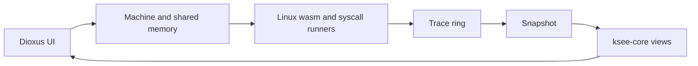

# kSEE

*Watch the real Linux kernel run, line by line, in your browser.*

kSEE (see the kernel; the kernel Syscall Execution Explorer) records an instrumented Linux run and lets you move
through it in both directions. You can follow source lines and call stacks,
inspect tasks and memory as they were at a selected moment, and see which
kernel objects a syscall changed.

The kernel is Linux stable `v7.2.7`, compiled directly to `wasm32` through a
minimal `arch/wasm` port. There is no CPU emulator. An LLVM pass records basic
blocks, calls, returns, stores, selected named variables, and branch
comparisons. That is enough to reconstruct a detailed history, subject to the
[recording limits](docs/design.md#limits).

## What you can inspect

A lesson runs a small program made of real syscalls. Its recording connects:

- a timeline of tasks and call stacks;
- the kernel source at the selected moment;
- arguments, locals, and pointed-to values as memory was then;
- every task's state and `task_struct`;
- the kernel objects changed by the selected syscall; and
- kernel and program console output.

You can edit the lesson program, run it again on a fresh kernel, and compare
what different calls do. kSEE is a replay interface, not a live debugger: the
kernel runs until quiet, then the page explores a snapshot of its trace.

## How it works



The page and host are one outer Rust WebAssembly module. That module owns
the memory, instantiates the Linux WebAssembly module inside it, and calls the
host's `Machine` directly. Linux tasks are suspended WebAssembly call stacks
scheduled with JSPI.

| Component | Responsibility |
|---|---|
| `arch/wasm/`, `linux.patch` and `linux/` | The port against Linux stable `v7.2.7`: its architecture, and its few edits to Linux's own files; `linux/` is fetched and patched on the first build, and `arch/wasm/` linked in. |
| `plugin/` | The LLVM 22 pass that inserts trace probes. |
| `ksee-host` | Owns memory, boots Linux, schedules JSPI-suspended task stacks, drives syscall runners, and takes snapshots. |
| `ksee-core` | Decodes trace records and packed metadata, then combines them with end-state memory to reconstruct stacks, lines, values, tasks, and objects. |
| `ksee-page` | The Dioxus UI in the host's WebAssembly module; it drives `Machine` and renders the reconstructed views. |
| `ksee-cli` | Builds, tests, serves, deploys, packs kernel metadata, and updates `linux.patch`. |
| `user/` | `/init`, the syscall runner, lesson definitions, and lesson filesystem fixtures. |

## Quick start

Automated setup supports Ubuntu 26.04 (`apt`):

```sh
./setup.sh
./ksee.sh
```

The first command installs the build toolchain. The second builds everything
that changed and serves `http://127.0.0.1:8000/`. Open it in a browser that
supports JSPI (`WebAssembly.Suspending`). The first build fetches the kernel and
creates the generated site under `target/site/`.

`./ksee.sh test` runs the tests in Chrome's headless shell, a pinned version it
fetches into `target/chrome/` the first time (`setup.sh` installs the
libraries it needs). The test command first runs the native `ksee-core` and `ksee-cli` tests, then
builds and runs the kernel and lessons suites in the browser. Add `--ui` for the page suites.
See the [getting-started guide](docs/getting-started.md) for prerequisites,
custom LLVM setup, and troubleshooting.

## Limits

kSEE is deliberately smaller than a complete Linux machine:

- There is no MMU, page-table behavior, copy-on-write, demand paging, or
  `fork`; threads and `vfork` are supported.
- It has one CPU and no preemption.
- Instrumentation records named variables kept in WebAssembly locals, branch
  comparisons, and memory stores, but not every compiler intermediate.
- The trace is a ring, so a long run can overwrite its oldest records.
- Large bulk stores may omit their old bytes, limiting reconstruction before
  that write.
- There is no console input or caught signal-handler execution.

The complete boundaries and rationale are in [the design](docs/design.md).

## Read next

- [Documentation index](docs/README.md): choose a guide by task.
- [Getting started](docs/getting-started.md): install, build, serve, and test.
- [User guide](docs/user-guide.md): follow a recording through the UI.
- [Lesson authoring](docs/lesson-authoring.md): write programs and explanatory links.
- [Development](docs/development.md): repository map, build pipeline, commands, and tests.
- [Architecture](docs/design.md): design choices, system boundaries, and limits.
