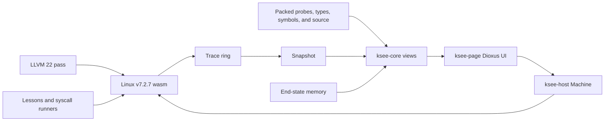

# kSEE design

## Goal

kSEE answers one question: *what did Linux do here, why, and where in the
source?*

It runs an instrumented Linux stable `v7.2.7` kernel in the browser and lets a
reader revisit the run in both directions. The recording follows basic blocks,
calls, returns, memory stores, selected named variables, and branch decisions.
It reconstructs source-line steps, call stacks, historical memory, tasks, and
changed objects from that trace, packed kernel metadata, and memory at the end
of the snapshot.

This is detailed coverage, not a claim that every source line or compiler value
is observable. Optimization, sealed functions, WebAssembly-local
intermediates, ring capacity, and large bulk stores impose explicit limits.

## Readers and boundaries

kSEE serves two related readers:

- A learner starts with a short syscall program and an explanation linked to
  the exact functions and state that answer a question.
- A kernel developer changes the program or kernel and inspects the real code
  path and typed state produced by that run.

kSEE is not a live debugger. It does not pause and mutate a running kernel; it
runs until quiet and explores a snapshot. It is not a profiler, a general
syscall playground, or a full machine. The kernel has no MMU or SMP and does
not support ordinary `fork`.

The [user guide](user-guide.md) explains the interface. This document explains
why the system is shaped as it is.

## System flow

Linux is compiled directly to WebAssembly through `arch/wasm`. No CPU is
emulated.

The Rust crate boundaries are:

- `ksee-core` is browser-independent. It decodes records and metadata,
  reconstructs the recording, parses lesson programs, and exposes named views.
- `ksee-host` owns the outer WebAssembly memory, instantiates Linux in it,
  schedules JSPI-suspended kernel task stacks, drives syscall runners, and
  takes snapshots. It depends on `ksee-core`.
- `ksee-page` is the Dioxus UI in the same outer WebAssembly module as the
  runtime. It depends on both runtime and core and calls `Machine` directly.
- `ksee-cli` is the native build tool. It builds and packs the kernel, browser
  module, programs, lessons, site, and tests; it uses core only for lesson
  text (the packer writes the formats core reads).

`web/` supplies the static frame and loader. `/init` and `/bin/prog` are
freestanding WebAssembly programs inside Linux. The latter waits for requests
from the page and makes each requested syscall as an ordinary Linux process.

## Design choices

### Real Linux, minimal port

The interesting behavior must be Linux's, not a model's. `arch/wasm` supplies
only what WebAssembly makes architecture-specific: task-stack suspension,
interrupt delivery, virtual time, program loading, and the host interface.
Generic kernel code, the VFS, ext4, the block layer, scheduler, futexes, and
other subsystems run directly.

### Compiler instrumentation, not subsystem hooks

The LLVM pass instruments functions uniformly. There is no list of interesting
syscalls, structs, or subsystems. That rule keeps a lesson free to follow an
unexpected call path and lets new kernel code participate without a dedicated
tracepoint.

Instrumentation runs after optimization so records describe emitted code.
Packed DWARF and probe tables reconnect that code to source names, types,
locations, inline chains, frame offsets, syscalls, and constants.

### Record, then reconstruct

The kernel is not stopped for inspection. From the program's first line,
probes append full events to a ring: the calls, and whatever the kernel does
between and meanwhile (the boot, before, is not recorded). The runtime snapshots the ring when the machine is quiet.

`ksee-core` then combines three inputs:

1. trace records, including the task a recording begins in (later switches
   are read from the calls and returns of the switch itself);
2. packed metadata from probes, DWARF, link addresses, and UAPI headers; and
3. end-state memory, with later stores undone to obtain an earlier moment.

This separation makes replay deterministic and lets most reconstruction logic
run in native unit tests with made-up records.

### One thread and one memory

The page/runtime module and Linux share one WebAssembly memory. Linux RAM sits
between the runtime's lower static region and its upper heap. The runtime can
read kernel objects and the trace ring directly, without workers, messages, or
a copied memory model.

A Linux task is a suspended call stack of the kernel instance. JSPI lets the
host suspend that stack at a context switch and resume another. Only one task
runs at a time, and host code runs while the kernel is suspended.

### Programs make real syscalls

The page does not call a special inspection syscall. It writes a request into
a runner's program memory and rings a doorbell interrupt. The runner wakes from
a futex and calls the kernel's ordinary syscall export. Threads and child
processes can become runners too, so one call may block while another task
wakes it.

### Rust owns both reconstruction and presentation

Core owns portable reconstruction and interaction rules that do not require a
browser. Runtime owns kernel execution. Page owns UI state, event handling, and
rendering. Dioxus renders the page, but the page is not a passive JavaScript
layout layer: it drives `Machine`, selects snapshots and moments, and asks core
views for the data it presents.

The contributor-facing module map is in [development.md](development.md).

## Experience

A lesson poses a question, explains a small program, and links its prose into
the resulting recording. A reader selects a syscall and moves through a
source-line cursor while the timeline, source, stack, tasks, objects, and
console remain synchronized. Editing a program reruns it on a fresh,
deterministic kernel.

The UI distinguishes raw trace records, reconstructed line steps, and sampled
chart columns. The full workflow and controls are in
[user-guide.md](user-guide.md).

## Limits

- **No MMU.** There are no page tables, page faults, copy-on-write, demand
  paging, or independent process address spaces. Ordinary `fork` is absent;
  threads and `vfork` share memory.
- **One CPU, no preemption.** The port selects `ARCH_NO_PREEMPT`; it cannot
  demonstrate SMP races or preemptive scheduling behavior.
- **Selected values, not every intermediate.** Stores are recorded. Named
  variables kept in WebAssembly locals, comparisons controlling branches, and
  copy origins are recorded where available. Unnamed compiler intermediates
  that remain in locals are not.
- **Optimized code.** Source can be removed, combined, moved, or inlined by the
  compiler. The replay follows the emitted code and debug metadata.
- **Sealed functions.** A loop that calls nothing and writes no memory that
  replay must undo records its call and return, but not each internal turn.
- **Finite ring.** Long recordings overwrite their oldest records. Stable
  record IDs preserve the identity of records still present.
- **Large bulk writes.** A bulk write beyond the retained limit records its
  address and length but not all old bytes. Earlier contents of that range
  cannot be reconstructed exactly.
- **Output-only console.** There is no console input or tty layer.
- **Signals.** Signals that stop or kill a task work, but caught signal-handler
  execution is not supported.
- **Browser capability.** The execution model requires JSPI through
  `WebAssembly.Suspending`.
